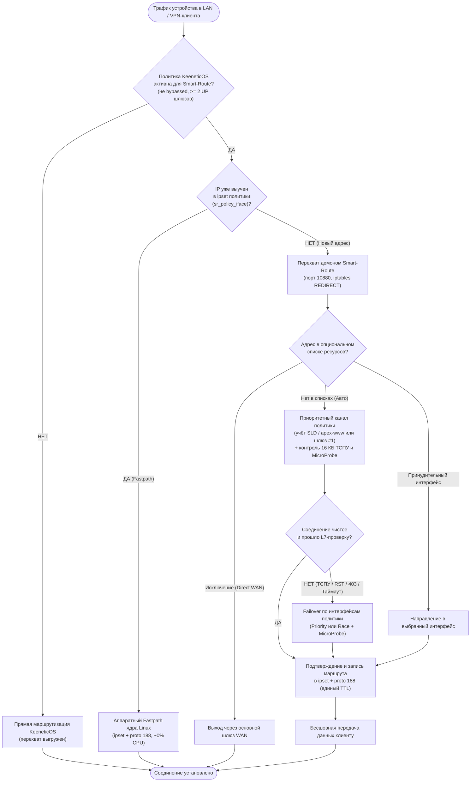

# Руководство пользователя и Архитектура Smart-Route (v1.1.0)

**Smart-Route** — это высокопроизводительный, легковесный системный сервис автономного обхода блокировок, динамической многоинтерфейсной маршрутизации (Failover Relay), встроенного DNS-прокси и аппаратной разгрузки ядра с автономным веб-интерфейсом для роутеров **Keenetic** (KeeneticOS 5.2 / 4.x) со средой **Entware**.

> **Важно:** Smart-Route **не содержит встроенных VPN-ядер** (Sing-box, Xray, Shadowsocks, WireGuard и т.п.). Он управляет маршрутизацией и бесшовным переключением трафика через уже настроенные на роутере интерфейсы и туннели KeeneticOS / Entware (WireGuard, AmneziaWG, OpenVPN, SSTP, `tun*`, резервный WAN или 4G/LTE-модем).

---

## 🎯 1. В чём главная идея Smart-Route?

Главная цель Smart-Route — полностью **автономный динамический обход блокировок без необходимости вручную вести статические списки сайтов и пресеты**:

1. **Бесшовный L4/L7 Failover**: незаблокированные ресурсы открываются напрямую через основной шлюз политики на максимальной скорости провайдера. При обнаружении блокировки или сбоя (таймаут TCP, RST-пакет, 16 КБ-блокировка ТСПУ/DPI с отложенной фиксацией WAN до 32 КБ, HTTP-заглушки и геоблокировки `403`/`451`) Smart-Route **на лету подхватывает соединение**, выбирает рабочий канал политики (`Priority` или `Race`) и передаёт ответ клиенту **без обрыва соединения в браузере**.
2. **Умный пробинг и точность детекции**:
   - Симметричный приоритетный SLD-пробинг (включая подсказки для `apex ↔ www` и родственных доменов) переставляет вероятный рабочий канал в начало очереди без преждевременной записи в `ipset`.
   - Лёгкая фоновая L7-проверка (`MicroProbe`) подтверждает чистоту ответа до фиксации маршрута в ядре, проверяет SSL-сертификат по конечному хосту после редиректа и корректно отличает решаемый Cloudflare Managed JS Challenge от жёсткой блокировки.
3. **Аппаратная разгрузка ядра (Kernel Offload via IPSet / `proto 188`)**: подтверждённый IP-адрес или подсеть сохраняется в `ipset` (`sr_<policy>_<iface>`) и маршрутизируется ядром Linux с настраиваемым TTL (по умолчанию 24 часа), снижая нагрузку на CPU при передаче трафика до ~0% и поддерживая HTTP/3 (QUIC) через выученные VPN-маршруты.
4. **Минимальные ресурсы и защита процесса**: сервис потребляет около **7–15 МБ RAM** и защищён от аварийной выгрузки ядром Linux (`oom_score_adj = -900`).

---

## 🏛️ 2. Блок-схема: Жизненный цикл соединения



---

## 🛡️ 3. Интеграция с политиками KeeneticOS (5.2 / 4.x) и Netfilter

- **Чтение живой конфигурации из RAM**: Smart-Route напрямую опрашивает `show rc ip policy`, `show interface` и `show ip policy`, мгновенно реагируя на изменение приоритетов, включение/отключение шлюзов и перенос устройств между политиками KeeneticOS.
- **Строгая изоляция политик**: каждая политика маршрутизации использует собственные наборы `ipset` (`sr_<policy>_<iface>`) и таблицы маршрутизации (`110..142` и `proto 188` в таблицах политик `4000..4999` / `254`). Для политик в режиме **Bypass** и политик с `0` или `1` активным шлюзом перехват автоматически выгружается.
- **Неразрушающее самовосстановление**: системный хук `/opt/etc/ndm/netfilter.d/01-smartroute.sh` (с фильтрацией UPnP и дебаунсом) отслеживает перестройки фаервола KeeneticOS и восстанавливает правила `iptables` / `ip rule` без сброса уже выученных маршрутов.

---

## 📋 4. Опциональные списки ресурсов и исключения

> **По умолчанию все встроенные списки и пресеты отключены**, чтобы основной обход блокировок работал полностью автономно.

Списки на вкладке **«Списки»** предназначены для случаев, когда нужно вручную принудительно направить конкретные домены, поддомены или подсети в выбранный интерфейс (либо исключить их из обхода):
- **Принудительная маршрутизация в VPN/WAN**: выбор одного или нескольких интерфейсов политики для конкретного набора доменов и CIDR.
- **Режим исключений**: принудительный прямой выход через основной шлюз без участия прокси-перехвата.
- **Онлайн-списки (URL) и каталог пресетов**: загрузка внешних списков (включая каталог **v2fly**) с автообновлением; при блокировке источника на основном канале загрузка автоматически выполняется через резервный VPN.
- **Дополнительные опции**: политика несоответствия интерфейсов (`policy_interfaces` или `block`) и фоновый прогрев DNS (`WarmupDNS`).

---

## 🌐 5. Встроенный DNS-прокси, блокировка трафика и BlackHole

1. **Встроенный DNS-прокси (вкладка «DNS»)**:
   - Поддержка **DoH**, **DoT**, **UDP** и **TCP** аплинков с маршрутизацией по доменным зонам (`[/ru/]`) и выходным интерфейсам (`if:...`, `geo:...`) с интерактивным помощником ввода при наборе `[`.
   - Два режима интеграции с роутером:
     - `dns_override` — прослушивание нативного порта `53` с освобождением от `ndnproxy` через `opkg dns-override`.
     - `iptables_hijack` — перехват DNS (`53 → 530`) через Netfilter (`SMART_ROUTE_DNS`), с опциональным перехватом клиентов входящих VPN-серверов и форвардингом локальных имён, частных PTR и KeenDNS в штатный `ndnproxy`.
   - Фильтры рекламы и нежелательных доменов (AdGuard / DNSBL), кэширование, фильтрация AAAA и встроенный тест скорости аплинков (холодный / повторный запрос).
2. **Аппаратная блокировка трафика (вкладка «Блокировка»)**:
   - Наборы правил `REJECT` (TCP RST) или `DROP` для всей сети, отдельных устройств Keenetic (IP/MAC), подсетей, политик и наборов `ipset`.
   - Гибкое расписание (дни недели, временные интервалы), готовые пресеты сервисов, ручные домены/IP и правила портов TCP/UDP.
3. **Интерфейс BlackHole**:
   - Создание и подключение изолированного виртуального интерфейса (`OpkgTun` L3 или `OpkgTap` L2) в KeeneticOS для гарантированной блокировки трафика без утечек в WAN.

---

## 🖥️ 6. Обзор разделов Веб-интерфейса

Единый автономный веб-интерфейс (Vue 3) упакован в предсжатый бандл без внешних CDN и доступен по адресу `http://192.168.1.1:8002` (или IP вашего роутера). Поддерживается **13 языков** с автоопределением языка KeeneticOS, тёмная/светлая тема, сворачиваемая консоль живых логов (WebSocket/SSE), 64K Demoscene (5 быстрых кликов по логотипу) и встроенное самообновление через OPKG по клику на версию в шапке.

```
┌─────────────────────────────────────────────────────────────────────────────────────────────────┐
│ ⚡ SmartRoute v1.1.0   [🟢 Активна] [CPU • RAM] [🌓 Тема] [Uptime]                 [⏹️ Стоп]    │
├───────────┬────────────┬────────┬──────────┬────────────┬──────┬────────────┬───────────────────┤
│ Состояние │ Интерфейсы │ Списки │ Маршруты │ Блокировка │ DNS  │ Настройки  │ Поблагодарить     │
└───────────┴────────────┴────────┴──────────┴────────────┴──────┴────────────┴───────────────────┘
```

1. **Состояние**: живые счётчики маршрутов, спасённых соединений, трафика WAN/VPN, статистика DNS, таблица последних обходов и интерактивный детальный тест маршрута по каждой политике (**Probe**).
2. **Интерфейсы**: список политик KeeneticOS, приоритеты выходных интерфейсов и перенос клиентов между политиками через Drag-and-Drop, настройка обхода политик (Bypass).
3. **Списки**: управление ручными и онлайн-списками доменов/подсетей, пресетами и исключениями.
4. **Маршруты**: таблица активных записей `ipset` с поиском, фильтрами по политикам/интерфейсам/типам, оставшимся TTL, причиной обучения и ручным добавлением/сбросом.
5. **Блокировка**: наборы правил аппаратной фильтрации с расписанием, пресетами, доменами и портами.
6. **DNS**: параметры DNS-прокси, режим интеграции (`dns_override` / `iptables_hijack`), настройка и тестирование аплинков, блок-листы.
7. **Настройки** (6 подразделов):
   - **Основные**: единый адаптивный таймаут подключения (`dial_timeout_ms`), единый TTL маршрутов (`route_ttl_minutes`), стратегия failover (`priority` / `race`), параметры SLD, Conntrack Watcher, `MicroProbe`, нейтрализация QUIC, порт/авторизация Web UI и язык интерфейса.
   - **Клиенты**: настройка входящих VPN-серверов роутера (SSTP, OpenConnect, WireGuard), автопоиск серверов и назначение политик для их подсетей.
   - **Keenetic (NDM)**: просмотр и диагностика системных маршрутов в таблицах KeeneticOS.
   - **BlackHole**: создание и управление слотом `OpkgTun` / `OpkgTap`.
   - **Диагностика**: System Doctor, таблица Conntrack, профайлер CPU/горутин, Prober интерфейсов, диагностика DNS и журнал Netfilter.
   - **Инспектор**: сетевой сниффер и анализ активных соединений клиентов в реальном времени.
8. **Поблагодарить автора**: реквизиты и ссылки поддержки разработки проекта.

---

## 🛠️ 7. Команды управления в консоли роутера (SSH)

```bash
# Проверить статус службы
/opt/etc/init.d/S99smart-route status

# Перезапустить службу
/opt/etc/init.d/S99smart-route restart

# Остановить службу (с автоматической очисткой правил iptables и ipset)
/opt/etc/init.d/S99smart-route stop

# Просмотр журнала логов (если включено логирование в файл)
tail -f /opt/var/log/smart-route.log

# Просмотр активных таблиц ipset Smart-Route
ipset list -n | grep -E '^sr_|^sr_blk_'
```

---

## 🚀 8. Быстрый старт: 3 простых шага

1. **Шаг 1**: Откройте `http://192.168.1.1:8002` и на вкладке **«Интерфейсы»** убедитесь, что в нужной политике KeeneticOS активно **не менее 2 шлюзов** (например, основной провайдер WAN и один или несколько VPN-туннелей).
2. **Шаг 2**: При необходимости откройте вкладку **«DNS»** для настройки встроенного DNS-прокси или вкладку **«Списки»**, если нужно принудительно направлять отдельные домены через выбранный канал.
3. **Шаг 3**: Пользуйтесь интернетом — заблокированные и сбойные ресурсы перехватываются и запоминаются в ядре автоматически без ведения ручных списков.

---

## 🗑️ 9. Полное удаление Smart-Route

### Автоматически:
```bash
curl -sSL https://raw.githubusercontent.com/snakelair/Keenetic/main/uninstall.sh | sh -s smart-route
```

### Вручную через SSH:
```bash
/opt/etc/init.d/S99smart-route stop
killall -9 smart-route 2>/dev/null
opkg remove smart-route --force-remove --force-depends
rm -f /opt/etc/init.d/S99smart-route /opt/etc/ndm/netfilter.d/01-smartroute.sh /tmp/smart-route.log /opt/var/log/smart-route.log /tmp/sr_ndm_dirty
rm -rf /opt/etc/smart-route

# Сброс правил iptables, таблиц маршрутизации и ipset
for t in $(seq 110 142) 188; do ip rule del lookup "$t" 2>/dev/null; ip route flush table "$t" 2>/dev/null; done
ip route flush table 254 proto 188 2>/dev/null
for t in $(ip rule show 2>/dev/null | awk '/lookup/ {print $NF}'); do case "$t" in 4[0-9][0-9][0-9]) ip route flush table "$t" proto 188 2>/dev/null;; esac; done
for ch in SMART_ROUTE_PREROUTING SMART_ROUTE_DNS SMART_ROUTE_BLOCK_NAT; do iptables -t nat -D PREROUTING -j "$ch" 2>/dev/null; iptables -t nat -F "$ch" 2>/dev/null; iptables -t nat -X "$ch" 2>/dev/null; done
iptables -t nat -D POSTROUTING -j SMART_ROUTE_POSTROUTING 2>/dev/null; iptables -t nat -F SMART_ROUTE_POSTROUTING 2>/dev/null; iptables -t nat -X SMART_ROUTE_POSTROUTING 2>/dev/null
for ch in SMART_ROUTE_MANGLE SMART_ROUTE_BLOCK_MANGLE; do iptables -t mangle -D PREROUTING -j "$ch" 2>/dev/null; iptables -t mangle -F "$ch" 2>/dev/null; iptables -t mangle -X "$ch" 2>/dev/null; done
for ch in SMART_ROUTE_FORWARD SMART_ROUTE_BLOCK; do iptables -t filter -D FORWARD -j "$ch" 2>/dev/null; iptables -t filter -F "$ch" 2>/dev/null; iptables -t filter -X "$ch" 2>/dev/null; done
iptables -t filter -D INPUT -j SMART_ROUTE_DNS 2>/dev/null; iptables -t filter -F SMART_ROUTE_DNS 2>/dev/null; iptables -t filter -X SMART_ROUTE_DNS 2>/dev/null
for s in $(ipset list -n 2>/dev/null | grep -E '^sr_|^sr_blk_'); do ipset flush "$s"; ipset destroy "$s"; done
```
